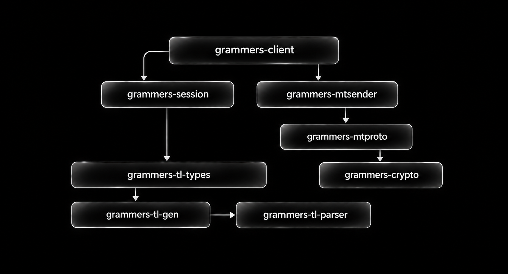

<p align="center"></p>
<h1 align="center">grammers</h1>
<p align="center">A Rust Telegram client with managed lifecycle, explicit session sources, and typed errors.</p>

<p align="center">
  <a href="https://xd-mohamed.github.io/grammers/"></a>
  <a href="https://xd-mohamed.github.io/grammers/api/grammers_client/"></a>
  <a href="grammers-client/examples/README.md"></a>
  <a href="CHANGELOG.md"></a>
</p>

This independently maintained fork builds on [Lonami's grammers](https://codeberg.org/Lonami/grammers). It keeps the raw MTProto APIs and adds an easier client interface, portable sessions, bounded work, and observable shutdown.

## Install

Use this repository for the fork APIs. For deployments, pin a reviewed commit with `rev` instead of following `main`.

```toml
[dependencies]
tokio = { version = "1", features = ["rt-multi-thread", "macros", "signal"] }

[dependencies.grammers-client]
git = "https://github.com/xD-Mohamed/grammers"
branch = "main"
features = ["session-file", "session-string", "session-import-files"]
```

## Quick start

```rust
use grammers_client::{Client, SessionSource};

#[tokio::main]
async fn main() -> Result<(), Box<dyn std::error::Error + Send + Sync>> {
    let api_id = std::env::var("TG_ID")?.parse()?;
    let client = Client::builder(api_id)
        .session(SessionSource::file("account.session"))
        .receive_updates(false)
        .build()
        .await?;

    client.run_until(tokio::signal::ctrl_c()).await?;
    Ok(())
}
```

This RPC-only example reuses a native SQLite session and disables update delivery. An empty session still needs login; connectivity is not proof of authorization. See the [examples](grammers-client/examples/README.md) for login, messages, updates, and transfers.

| Method | Behavior |
| --- | --- |
| `build().await` | Validate settings and prepare local storage, without network activity. |
| `start().await` | Start the shared driver once; connections remain lazy. |
| `connect().await` | Start and check home-DC connectivity. |
| `run().await` | Connect, then wait for stop or terminal failure. |
| `run_until(future).await` | Run until a shutdown future resolves, then await stop. |
| `stop().await` | Stop accepting work and await bounded shutdown. |

Clones share the same lifecycle. Stop is terminal and idempotent; build another client from the same storage to restart. Existing externally managed `SenderPool` clients remain supported.

## Sessions

Choose a format explicitly. Strings are never guessed to be paths, and foreign session files are never migrated or overwritten.

| Source | Constructor |
| --- | --- |
| Native SQLite file | `SessionSource::file("account.session")` |
| Native string | `SessionSource::native(text)` |
| Pyrogram / compatible Kurigram string | `SessionSource::pyrogram(text)` |
| Telethon v1 string | `SessionSource::telethon(text)` |
| Pyrogram / Kurigram SQLite file | `SessionSource::pyrogram_file(path)` |
| Telethon SQLite file | `SessionSource::telethon_file(path)` |
| gotd Loader v1 JSON file | `SessionSource::gotd_file(path)` |
| gotd Loader v1 JSON text | `SessionSource::gotd(text)` |
| Temporary memory | `SessionSource::memory()` |
| Custom storage | `SessionSource::storage(Arc::new(storage))` |

Foreign formats import into independent memory storage. SQLite versions are validated, and active journals are rejected instead of reading stale credentials. See [session formats](grammers-session/README.md) for exact compatibility and direct parsers such as `parse_telethon_string`.

Export the native format from a client with a home-DC key, including clients opened from Pyrogram, Telethon, or gotd:

```rust
let session: String = client.export_session_string()?;
let restored = Client::builder(api_id)
    .session(SessionSource::native(session))
    .build()
    .await?;
```

The shape is `grammers:1:<base64url payload and checksum>`, currently 454 ASCII characters. It preserves the home key, exact IPv4/IPv6 endpoints, and address preference. It excludes other-DC keys, peer caches, and update checkpoints. Treat the returned string as a credential; use `export_session_secret()` instead when you want a wrapper with redacted `Debug`. The application's API ID always comes from your configuration.

An [offline demonstration](grammers-session/examples/session_string_demo.rs) prints a synthetic string and verifies its round-trip without reading credentials or contacting Telegram.

## Configuration

Device settings are grouped and optional. Omitted values retain platform defaults.

```rust
use grammers_client::{Client, DeviceConfig, SessionSource};

let client = Client::builder(api_id)
    .session(SessionSource::file("account.session"))
    .device(DeviceConfig {
        device_model: "My application".into(),
        app_version: env!("CARGO_PKG_VERSION").into(),
        ..Default::default()
    })
    .max_pending_requests(1024)
    .build()
    .await?;
```

Managed defaults: 30-second connection initialization, 10-second shutdown, and 1024 queued/in-flight requests. The default retry policy respects short Telegram waits without automatically replaying I/O failures. Configure IPv6, proxy, updates, and retry policy when needed; advanced callers can supply `ConnectionParams`.

## Messages and errors

Ordinary messages need only a recipient and text:

```rust
client.send_message(peer, "Hello").await?;
```

Optional settings support defaults:

```rust
use grammers_client::SendOptions;

client.send_message_with_options(peer, "Hello", SendOptions {
    silent: true,
    ..Default::default()
}).await?;
```

`InvocationError::category()`, `retry_after()`, and `is_flood_wait()` help applications handle failures without parsing display text. Original errors remain available. `Client::status()` and `events()` expose connection, admission, overflow, and termination information without request bodies or credentials.

A timeout or missing reply does not prove a request was never sent. Sent requests retain their SDK reservations until protocol retirement or teardown. Do not blindly retry state-changing operations after uncertain failures.

## Features

| Feature | Adds |
| --- | --- |
| `fs` (default) | Filesystem transfer helpers |
| `session-file` | Native SQLite source |
| `session-string` | Native portable session import/export |
| `session-import` | Pyrogram, Telethon, and gotd text decoders |
| `session-import-files` | Explicit read-only foreign file imports |
| `dispatcher` | Composable filters and sequential handlers |
| `qr-login` | QR login steps and 2FA integration |
| `markdown`, `html` | Message formatting parsers |
| `proxy` | SOCKS5 support |
| `parse_invite_link` | Invite-link parsing |

Memory-only session builds do not require SQLite. Native strings and external importers are independently optional.

## Crates



| Crate | Responsibility |
| --- | --- |
| [grammers-client](grammers-client/) | Managed client, messages, media, login, and updates |
| [grammers-session](grammers-session/) | Storage, portable strings, and explicit imports |
| [grammers-mtsender](grammers-mtsender/) | Connections, routing, request lifetime, retry policies |
| [grammers-mtproto](grammers-mtproto/) | MTProto framing and protocol state |
| [grammers-crypto](grammers-crypto/) | Cryptographic primitives and authentication helpers |
| [grammers-tl-types](grammers-tl-types/) | Generated Telegram types and RPC functions |
| [grammers-tl-gen](grammers-tl-gen/) | Rust generation from TL definitions |
| [grammers-tl-parser](grammers-tl-parser/) | TL schema parsing |

The diagram shows the main dependencies. The [API reference](https://xd-mohamed.github.io/grammers/api/grammers_client/) is generated automatically for the workspace's public methods, types, traits, and examples.

## Development

```sh
cargo fmt --all -- --check
cargo test --locked --release --workspace --all-features
cargo check --locked --workspace --all-targets --all-features
cargo clippy --locked --workspace --all-targets --all-features -- -D warnings
```

GitHub Actions checks Windows/Linux and optional builds. GitHub Pages regenerates the guide and complete Rust reference on updates to `main`. Build locally with `python scripts/build-docs.py`.

Install the build-only documentation tools with `python -m pip install -r docs/requirements.txt`. Method pages are generated from Rustdoc; Telegram account-availability metadata is cached with provenance and refreshed for new schema methods. Where official metadata is missing or does not match the local constructor, the reference says so.

See [contributing](CONTRIBUTING.md), [upstream policy](UPSTREAM.md), [changes](CHANGELOG.md), and [performance notes](PERFORMANCE.md). Upstream changes enter review branches. Offline checks do not establish live authorization, deployment, or universal performance gains. CDN redirects currently return a clear unsupported error; full CDN transfers are not implemented.

## License

MIT or Apache-2.0, at your option. Original upstream history, authorship, and notices are retained. See [LICENSE-MIT](LICENSE-MIT) and [LICENSE-APACHE](LICENSE-APACHE).
